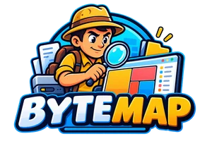
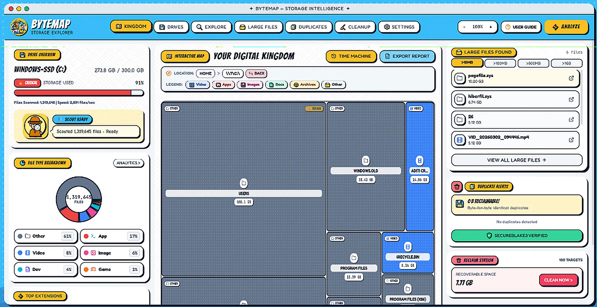
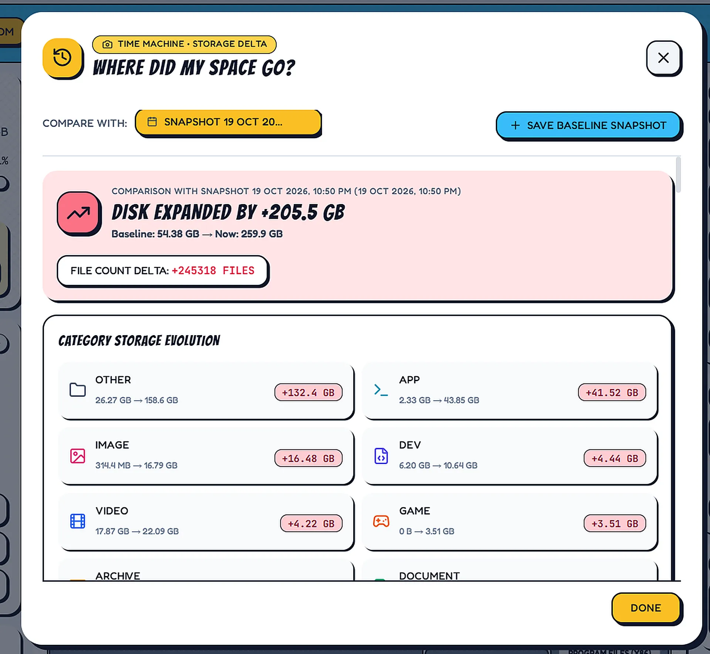
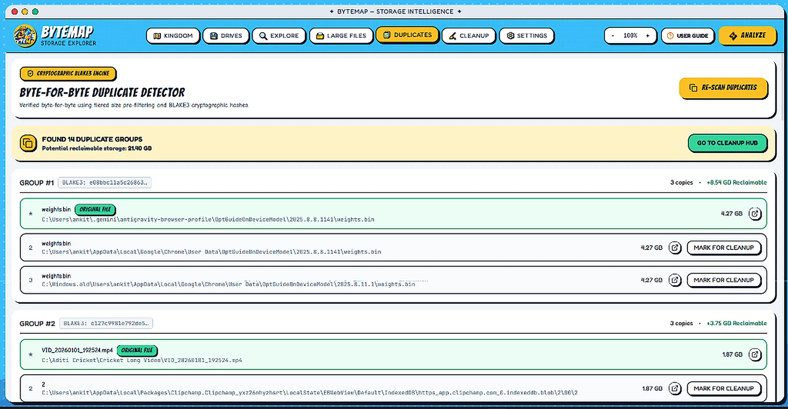
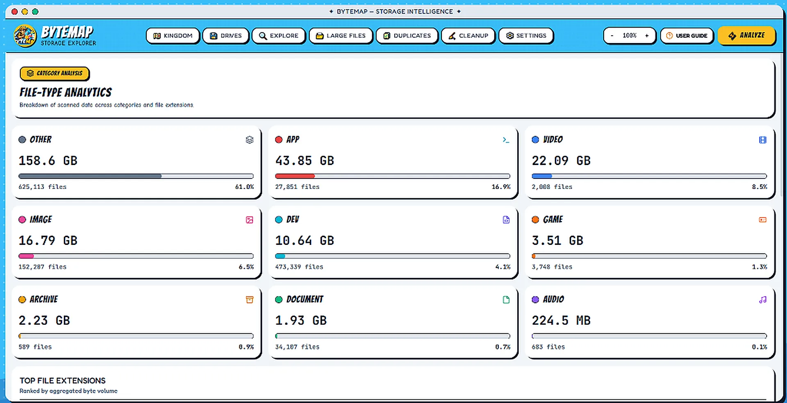

<p align="center">
  
</p>

<h1 align="center">ByteMap</h1>

<p align="center">
  <strong>Desktop Storage Intelligence for Windows & macOS</strong><br />
  A blazing fast, offline, and beautifully animated visualizer to see where your disk space <em>actually</em> went.
</p>

<p align="center">
  <a href="https://github.com/ankitpandey1900/ByteMap/releases/latest"></a>
  <a href="https://bytemap.alltracker.online/"></a>
  
  
  
  
  <a href="LICENSE"></a>
</p>

<p align="center">
  <a href="https://github.com/ankitpandey1900/ByteMap/releases/download/v1.0.9/ByteMap_1.0.9_x64-setup.exe"><strong>🪟 Download for Windows (.exe)</strong></a> &nbsp;•&nbsp;
  <a href="https://github.com/ankitpandey1900/ByteMap/releases/download/v1.0.9/ByteMap_1.0.9_universal.dmg"><strong>🍏 Download for Mac (.dmg Universal)</strong></a> &nbsp;•&nbsp;
  <a href="https://github.com/ankitpandey1900/ByteMap/releases/download/v1.0.9/ByteMap_1.0.9_x64_en-US.msi"><strong>🏢 Windows MSI Package</strong></a>
</p>

---

<p align="center">
  
</p>

---

## Why I Built This

Most disk space analyzers fall into one of two traps:
1. **The 90s tools** (like WinDirStat): They freeze your UI while scanning, run on a single thread, and look like Windows 98 software.
2. **The modern commercial bloatware**: Sluggish Electron wrappers that quietly dump a 3GB SQLite database or hidden cache on your SSD just to tell you that you have 3GB of temp files... and then nag you for a $39/year subscription.

I wanted something different:
- **Native Rust Parallel Threads**: Chews through 100,000+ files in seconds without stuttering or dropping frames.
- **Vibrant Pop-Art Interactive Map**: Squarified Treemap with category spotlighting instead of drab grey tables.
- **Zero-DB Volatile Memory Architecture**: All scan metadata lives strictly in RAM while the app is running. The millisecond you close the window, **poof — zero databases, zero SQLite files, zero leftover cache**.
- **Safe by Default**: Moves files to your OS Recycle Bin / Trash with instant parent folder size roll-down and a 1-click shortcut to empty the trash.

---

## Visual Feature Tour

### 1. Interactive Digital Kingdom (Squarified Treemap)
Visualize your entire filesystem as responsive, nested comic rectangles. Drill down into subfolders with zero latency, spotlight specific categories (Videos, Code, Archives), and jump back using breadcrumbs.

<p align="center">
  
</p>

---

### 2. Time Machine ("Where Did My Space Go?")
Caught 20GB vanishing mysteriously overnight? ByteMap saves lightweight, private baseline snapshots and compares directory sizes over time, pinpointing every swollen directory with a delta breakdown.

<p align="center">
  
</p>

---

### 3. Cryptographic BLAKE3 Duplicate Detector
Never guess based on filename alone. ByteMap uses a staged 3-tier engine:
1. Exact file size match.
2. 4KB header hash prefix check.
3. Cryptographic **BLAKE3 full-file hash** only on genuine collision candidates.

<p align="center">
  
</p>

---

### 4. Developer Build Bloat & Ghost Sweeper
Reclaim gigabytes from hidden AI caches, IDE session artifacts, package managers (`npm`, `pnpm`, `Cargo`, `pip`, `Gradle`, `Go`), and stale build folders (`node_modules`, `target`, `.venv`, `.next`, `dist`). Also prunes 0-byte ghost folders while keeping your source code 100% untouched.

---

### 5. Live Folder Hierarchy Rollup & Native Trash Shortcut *(New in v1.0.9)*
When you clean files or directories:
- **Instant Roll-down**: Ancestor folders dynamically recalculate their sizes (`size_bytes`) and file counts in memory with 0ms latency.
- **Smart Treemap Stepback**: If you were drilled down into a deleted directory, the Treemap gracefully steps back to the closest surviving parent folder.
- **Recycle Bin Clarification & Quick-Action**: Clearly explains why Windows OS disk capacity frees up after emptying the Recycle Bin, and provides a 1-click native shortcut to open the OS Recycle Bin / Trash.

---

### 6. Storage Analytics & Standalone HTML Reports
Get an instant category donut breakdown, inspect the top large files from 10MB to 5GB+ monsters, and export a self-contained, offline HTML audit report with interactive charts for IT or colleagues.

<p align="center">
  
</p>

---

## Feature Comparison

| Capability | ByteMap (v1.0.9) | Legacy WinDirStat | Commercial Cleaners |
| :--- | :---: | :---: | :---: |
| **Engine Speed** | Native Multi-Threaded Rust | Single-threaded Win32 | Heavy Node.js / Electron |
| **Storage Architecture** | Zero Database (Volatile RAM) | In-Memory (No snapshots) | Persistent SQLite / Registry |
| **Time Machine Snapshots** | Lightweight Historical Diffs | ❌ Not available | ❌ Not available |
| **Duplicate Engine** | Cryptographic BLAKE3 | ❌ Not available | Filename matching only |
| **Developer Caches Sweeper** | Built-in (`node_modules`, `target`, `venv`) | ❌ Not available | Paid Add-on |
| **Telemetry & Tracking** | Zero Outbound Telemetry | Offline | Telemetry / Account required |
| **Safety Guard** | Recycle Bin Default + System Protection | Permanent delete by default | Black-box deletion |
| **Pricing** | **100% Free & Open Source (MIT)** | Free | $29–$49/year |

---

## Safety, Privacy & Security Rules

1. **Path Boundary Validation**: Before any deletion, the backend canonicalizes the target path and confirms it sits strictly inside the authorized directory you chose to scan. Path traversal attacks (`../`) are blocked.
2. **System Root Guard**: Hardcoded safety rules protect critical operating system folders (`C:\Windows`, `C:\Program Files`, `/usr`, `/bin`, root drives).
3. **Pre-Deletion Sanity Check**: Immediately before deleting or trashing an item, ByteMap re-verifies that the target exists and that its byte length matches the scan snapshot. If the file was changed in the background, ByteMap refuses to touch it.
4. **Recycle Bin by Default**: Deletions use the native system trash API (`trash` crate on Windows/macOS/Linux) so you can easily restore any accidental deletion.
5. **Zero Outbound Traffic**: The desktop app contains zero telemetry, analytics, or background internet pings.

---

## Tech Stack

* **Core Desktop Framework**: [Tauri 2](https://v2.tauri.app/) (native OS webview, minimal memory footprint)
* **Backend Engine**: Rust 2021, `walkdir`, `blake3`, `sysinfo`, `trash`, `rayon`
* **Frontend**: React 19, TypeScript (strict mode), Vite, Tailwind CSS, Recharts, Zustand, Lucide Icons
* **Testing & Quality**: Vitest, React Testing Library, `cargo fmt`, `clippy`

---

## Getting Started (Developers)

### Prerequisites
1. **Node.js** (v20+) & **pnpm**:
   ```bash
   corepack enable
   corepack prepare pnpm@latest --activate
   ```
2. **Rust**:
   Install via [rustup.rs](https://rustup.rs).
3. **C++ Build Tools**:
   * **Windows**: Visual Studio C++ Build Tools (or LLVM + Windows SDK).
   * **macOS**: `xcode-select --install`
   * **Linux**: `libwebkit2gtk-4.1-dev`, `build-essential`, `curl`, `wget`

### Installation & Local Run

```bash
# 1. Clone the repository
git clone https://github.com/ankitpandey1900/ByteMap.git
cd ByteMap

# 2. Install dependencies
pnpm install

# 3. Launch desktop app in development mode
pnpm tauri dev

# 4. Run automated test suite
pnpm test

# 5. Build native production installer
pnpm tauri build
```

---

## Documentation & Architecture

* 📖 **[User Guide (Survival Manual)](docs/USER_GUIDE.md)**: Plain-English walkthrough of common fixes and workflows.
* 🏗️ **[System Design & Architecture](docs/SYSTEM_DESIGN.md)**: Deep dive into threading models, volatile RAM policies, and sequence flows.
* 📋 **[Architecture Decision Records (ADRs)](docs/ADR/)**: Why we chose Tauri 2 over Electron, BLAKE3 over MD5/SHA256, and volatile memory over SQLite.

---

## Author

<table>
  <tr>
    <td width="100" align="center">
      
    </td>
    <td>
      <strong>Ankit Pandey</strong><br />
      <em>"I build products. Life? Still in debugging mode."</em><br /><br />
      🌐 <a href="https://bytemap.alltracker.online/">ByteMap Website</a> &nbsp;•&nbsp;
      💼 <a href="https://ankitpandey19.vercel.app/">Personal Portfolio</a> &nbsp;•&nbsp;
      🐙 <a href="https://github.com/ankitpandey1900">GitHub Profile</a> &nbsp;•&nbsp;
      ✉️ <a href="mailto:ankit1pandey11@gmail.com">ankit1pandey11@gmail.com</a>
    </td>
  </tr>
</table>

---

## License

This project is licensed under the **MIT License** — see the [LICENSE](LICENSE) file for details.
