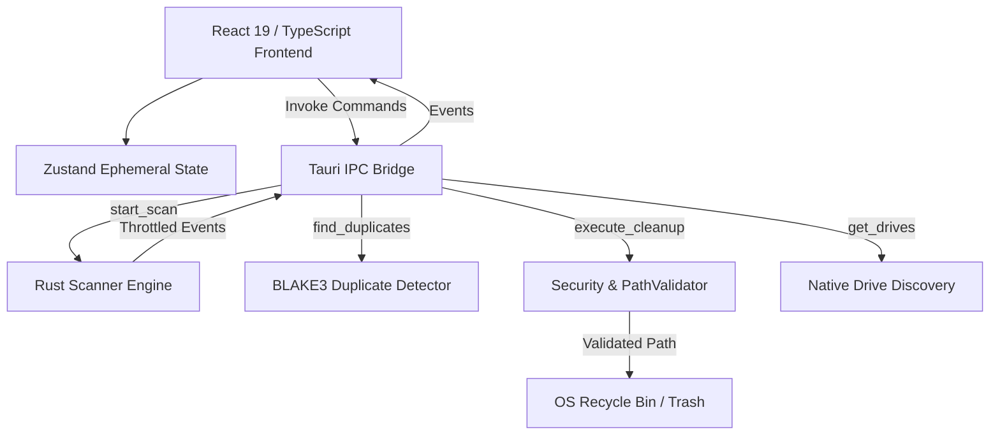

# ByteMap Architecture Documentation

This document describes the architectural design, component boundaries, execution flows, and IPC contracts of ByteMap.

---

## 1. Architectural Overview

ByteMap adheres to a strict separation of concerns between:
1. **Rust Backend Core**: Handles high-performance asynchronous filesystem traversal, native drive metrics, cryptographic hashing, and destructive cleanup validation.
2. **React/TypeScript Desktop UI**: Manages rendering, squarified treemaps, charts, interactive drill-downs, and user selection.
3. **IPC Bridge**: Strongly-typed Tauri commands and events with strict payload validation.

---

## 2. In-Memory State Model (Strict No-Database Policy)

ByteMap explicitly complies with the **strict no-database policy**:
- **No SQLite, PostgreSQL, MySQL, Redis, or embedded DBs**.
- **No IndexedDB or LocalStorage file catalogs**.
- When a scan runs, summary aggregates and metadata reside in a thread-safe `Arc<Mutex<Option<ScanSummary>>>` in RAM.
- When the user clears the scan or quits the application, all file metadata is completely erased from volatile memory.
- User settings (theme, display units, default exclusions) are preserved in `%APPDATA%\ByteMap\config.json`. This config file contains **no file paths, scan indexes, or personal data**.

---

## 3. Tauri Command & Event Contracts

### Commands

| Command | Arguments | Return Type | Description |
| :--- | :--- | :--- | :--- |
| `get_drives` | None | `Vec<DriveInfo>` | Retrieves physical disks, mount points, format, total/available space. |
| `start_scan` | `options: ScanOptions` | `ScanSummary` | Spawns worker thread, executes traversal, streams progress events. |
| `cancel_scan` | None | `()` | Atomically flags scan cancellation. |
| `get_scan_summary` | None | `Option<ScanSummary>` | Returns current in-memory scan results. |
| `clear_scan_data` | None | `()` | Immediately drops in-memory scan records. |
| `find_duplicates` | None | `Vec<DuplicateGroup>` | Performs staged BLAKE3 cryptographic duplicate analysis. |
| `execute_cleanup` | `targets: Vec<CleanupTargetRequest>, prefer_trash: bool` | `CleanupExecutionSummary` | Validates target files and executes safe trash/delete. |
| `reveal_in_folder`| `path: String` | `()` | Safely opens native OS file manager to the file. |
| `load_settings` | None | `AppSettings` | Loads non-sensitive settings from config directory. |
| `save_settings` | `settings: AppSettings` | `()` | Persists non-sensitive preferences. |

### Events

| Event Name | Direction | Payload Type | Description |
| :--- | :--- | :--- | :--- |
| `scan_progress` | Rust -> UI | `ScanProgress` | Emitted every ~80ms during directory traversal with counts and current path. |
| `duplicate_progress` | Rust -> UI | `(usize, usize)` | Emitted during hashing showing (processed, total) candidate files. |

---

## 4. Scan Engine Lifecycle

1. **Validation**: User specifies a path. Backend calls `PathValidator::validate_scan_root` to verify canonical directory existence.
2. **Cancellation Token**: An `Arc<AtomicBool>` is initialized and shared between the scan thread and the cancel handler.
3. **Traversal**: `WalkDir` recursively discovers entries without following symlinks by default.
4. **Aggregation Pass**: File sizes are incrementally rolled up into parents using a hash table of paths to sizes and counts.
5. **Categorization**: Extensions are mapped to standard categories (`Video`, `Image`, `Document`, etc.).
6. **Top Rankings**: Largest files (top 100) and largest directories (top 50) are extracted.
7. **Cleanup Rules**: Heuristics identify temp files, obsolete installers, and massive downloads.
8. **Completion Event**: Final summary is saved in application RAM and returned to UI.
