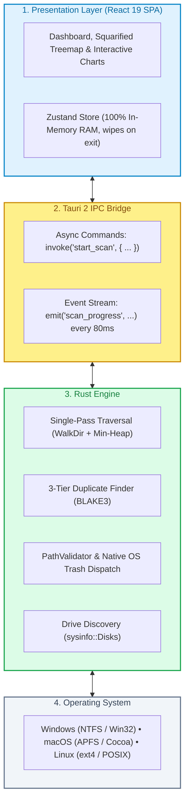
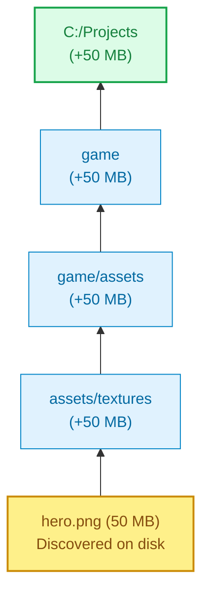
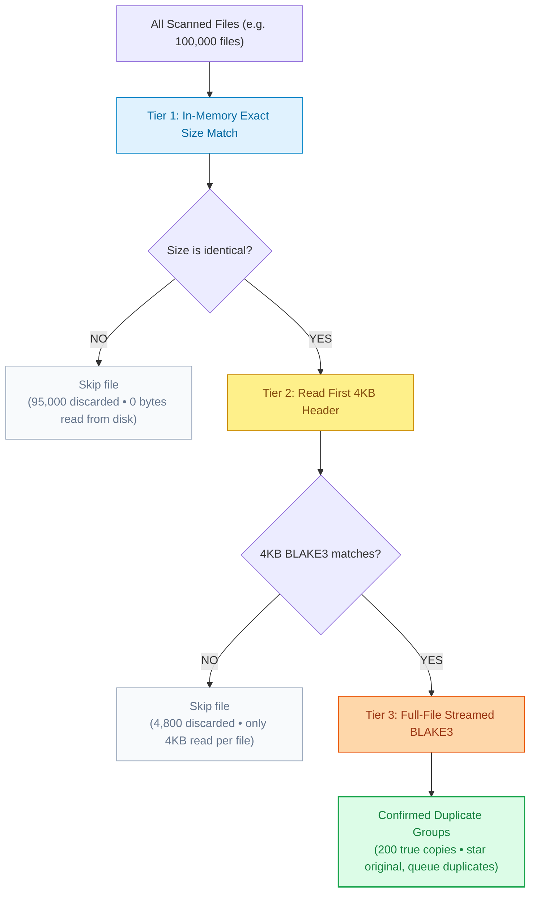
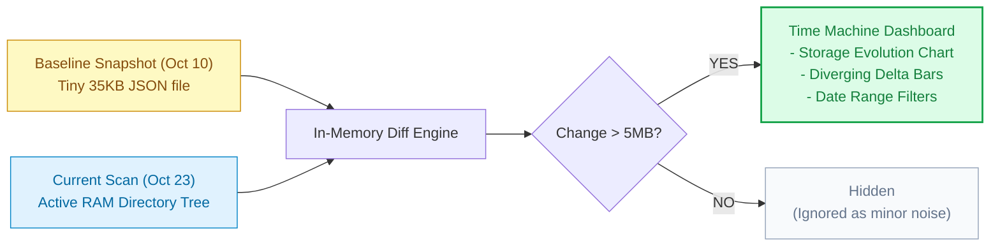
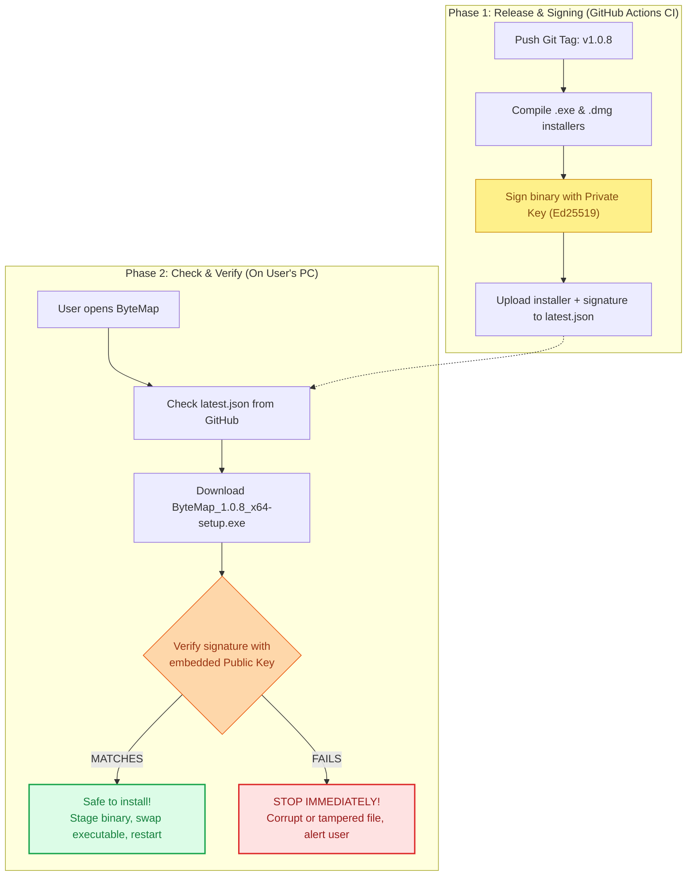
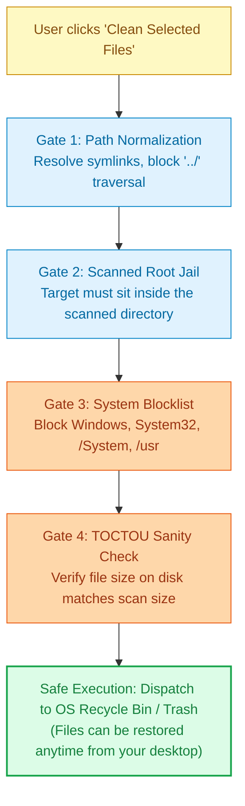
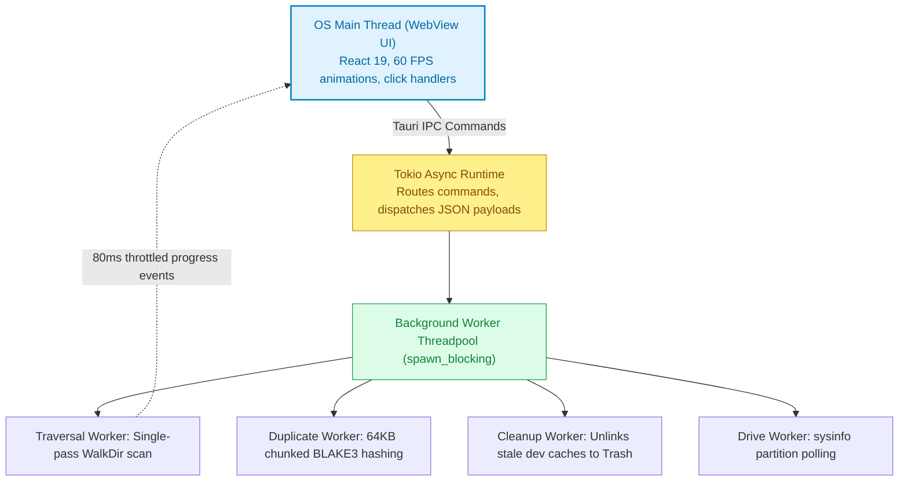

# ByteMap — System Design & Architecture

How ByteMap works under the hood: architecture, threading, algorithms, data flow, and safety mechanisms.

- **Author**: Ankit Pandey
- **Repository**: [github.com/ankitpandey1900/ByteMap](https://github.com/ankitpandey1900/ByteMap)
- **Live Site**: [bytemap.alltracker.online](https://bytemap.alltracker.online/)
- **Version**: 1.0.8

---

## 1. Why I Built ByteMap & The Core Design Rules

Most disk space analyzers fall into one of two traps:
1. **The 90s tools** (like WinDirStat): They freeze your UI while scanning, run on a single thread, and look like Windows 98.
2. **The modern commercial cleaners**: They're built on heavy Electron frameworks that chew up 400MB of RAM at idle, install hidden background daemons, write huge multi-gigabyte SQLite databases to your SSD, and collect telemetry.

I built ByteMap to be fast, beautiful, and completely respectful of your machine:

| Principle | How We Enforce It |
| :--- | :--- |
| **1. Zero Database Policy** | All scan data lives strictly in RAM. Close the app, and everything vanishes. No disk caches, no ghost files. |
| **2. Native Rust Performance** | Scans run on native OS threads using compiled Rust. Scans a 1TB drive in ~4 seconds on NVMe. |
| **3. 80ms Throttled IPC** | Rust batches updates every 80ms (~12/sec) so the UI stays silky smooth at 60 FPS. |
| **4. Smart Duplicate Funnel** | We don't hash every file. A 3-stage funnel filters out 99% before reading byte streams. |
| **5. Safe By Default** | Deletions always default to the Recycle Bin / Trash. System paths are protected. |

---

## 2. High-Level Architecture

ByteMap is split into three main layers: the **React UI**, the **Tauri IPC Bridge**, and the **Rust Core Engine**.



---

## 3. How the Core Systems Actually Work

### 3.1 Single-Pass Directory Traversal & Hierarchical Rollup

When people think about calculating folder sizes, they usually imagine recursively walking every folder over and over. That's slow and thrashes the disk.

In ByteMap, I use a **single-pass prefix rollup**:
When the scanner hits a file on disk, that file's size immediately bubbles up to all its parent folders in our in-memory hash map. We only read each file's metadata **once**.



In memory, we maintain a flat `HashMap<PathBuf, DirectoryStats>`:

```
  "C:\Projects"               =>  size: 50 MB,  files: 1
  "C:\Projects\game"          =>  size: 50 MB,  files: 1
  "C:\Projects\game\assets"   =>  size: 50 MB,  files: 1
```

Next, if the scanner encounters `C:\Projects\game\assets\sound.wav` (20 MB):
- `"C:\Projects\game\assets"` becomes `70 MB` (2 files)
- `"C:\Projects\game"` becomes `70 MB` (2 files)
- `"C:\Projects"` becomes `70 MB` (2 files)

#### Why this is so fast:
- **Zero redundant I/O**: We never re-scan or backtrack through directories.
- **Top-100 Min-Heap**: While walking, we keep a fixed-size Min-Heap of the top 100 largest files. If a new file is smaller than the smallest item in the heap, we drop it instantly without sorting.
- **80ms Telemetry Throttle**: If we sent a message to the frontend for every file scanned, the IPC bridge would lock up when scanning 400,000 files. Instead, Rust emits a progress update once every 80 milliseconds (~12 updates a second), reporting current path, files processed, and scan speed.

---

### 3.2 Duplicate Detection: The 3-Stage Elimination Funnel

Scanning 500,000 files for byte-exact duplicates by computing cryptographic hashes for everything would grind your disk to a halt. 

ByteMap solves this with an **elimination funnel** that throws out 99.9% of files before reading full byte streams:



#### Why BLAKE3?
- BLAKE3 is a modern cryptographic tree hasher that runs at **~3.8 GB/s per core** using SIMD vector instructions (AVX-512, NEON).
- It is significantly faster than SHA-256 and MD5, allowing us to hash large files as fast as NVMe drives can stream them.

---

### 3.3 The Squarified Treemap: Why Tiles Look Like Squares, Not Slivers

Traditional disk visualizers often slice rectangles down to 1-pixel thin vertical or horizontal strips. You can't read the folder names, and you can't click them:

```
  Naive Slicing (Ugly Slivers):       Squarified Layout (ByteMap):
  ┌──┬──┬──┬──┬──┬──────────────┐      ┌──────────────┬──────────────┐
  │  │  │  │  │  │              │      │              │   Games      │
  │  │  │  │  │  │   Movies     │      │   Movies     │   (30 GB)    │
  │  │  │  │  │  │   (50 GB)    │      │   (50 GB)    ├──────┬───────┤
  │  │  │  │  │  │              │      │              │ Code │ Docs  │
  └──┴──┴──┴──┴──┴──────────────┘      └──────────────┴──────┴───────┘
   ▲ These slivers are unclickable!      ▲ Clean, readable square tiles!
```

ByteMap implements the **Squarified algorithm** (*Bruls, Huizing, van Wijk*):
1. Take the available screen area (width $\times$ height).
2. Greedily arrange items into rows along the shorter edge.
3. Keep adding items to the current row as long as the aspect ratio stays close to a square ($1:1$).
4. As soon as adding another rectangle makes the tile long and skinny, lock that row, cut off the remaining space, and start a new row.
5. Every tile gets a deterministic color from a 16-color comic palette based on its name, plus a 3D translucent top sheen and dark ink outline.

---

### 3.4 Time Machine: Storage Diff Without Any Database

How do you answer *"Where did 20 GB vanish overnight?"* without running a heavy background database?



- **Tiny Signature File**: A baseline snapshot doesn't save file lists or personal data. It only stores folder path strings and their byte sizes. A scan of 300,000 files compresses into a ~35KB signature file.
- **Date Range Engine**: You can filter snapshots by "All Time", "Today", "Last 7 Days", "Last 30 Days", or pick exact "From" and "To" dates to inspect specific software installation windows.

---

### 3.5 How the Cryptographic Auto-Updater Works

I wanted updates to be automatic, seamless, and mathematically secure against tampering or malicious network injection. Here is the simplified two-phase flow:



1. **At build time (CI/CD)**: GitHub Actions builds the binaries and signs them with an Ed25519 Minisign private key. The resulting signature is saved in `latest.json`.
2. **At run time (User's PC)**: When the app checks for updates, it compares the downloaded binary against the signature using the public key embedded in `tauri.conf.json`. If even a single byte was altered, the cryptographic verification fails and the update is immediately blocked.

---

### 3.6 Safety First: The 4-Step Cleanup Guard (`PathValidator`)

Deleting files can be dangerous if software makes assumptions. Before ByteMap moves a single file to the Recycle Bin or purges a dev cache, it passes the target through **four strict security gates**:



---

## 4. Concurrency & Threading Model

ByteMap maintains strict thread isolation so that UI interactions, charts, and animations never stutter during disk-heavy operations:



---

## 5. Cross-Platform Abstraction

ByteMap runs identically on Windows, macOS, and Linux by abstracting platform-specific system calls:

| Subsystem | Windows (10 / 11) | macOS (Apple Silicon / Intel) | Linux (Ubuntu / Fedora / Arch) |
| :--- | :--- | :--- | :--- |
| **Webview Runtime** | WebView2 (Chromium) | WebKit (Native Apple runtime) | WebKitGTK 4.1 |
| **Filesystem Traversal** | Win32 `FindFirstFileW` | POSIX `getdirentries` | POSIX `readdir_r` |
| **Trash Engine** | Windows Recycle Bin (`IFileOperation`) | macOS Trash (`NSWorkspace`) | FreeDesktop.org Trash Spec |
| **Path Normalization** | Strips `\\?\` NT extended prefix | Standard POSIX paths | Standard POSIX paths |
| **Installers** | Setup `.exe` (NSIS), `.msi` | Universal `.dmg` | `.deb`, `.AppImage` |
| **Protected Folders** | `C:\Windows`, `C:\Program Files` | `/System`, `/Library`, `/Applications`| `/bin`, `/usr`, `/etc`, `/sys` |

---

## 6. How We Verify Quality

- **35 Unit Tests**: Vitest test suites verify in-memory store actions, Time Machine date filters, path sanitization, and byte formatting utilities.
- **Strict TypeScript**: `tsc --noEmit` validates all frontend types with zero `any` escapes in core business logic.
- **Rust Safety**: `cargo fmt -- --check` and `cargo clippy` keep Rust code clean and warning-free.
- **Zero Memory Leaks**: Clearing a scan drops all references, releasing allocated heap memory back to the OS immediately.
