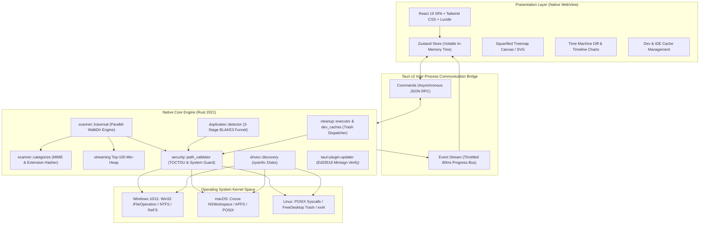
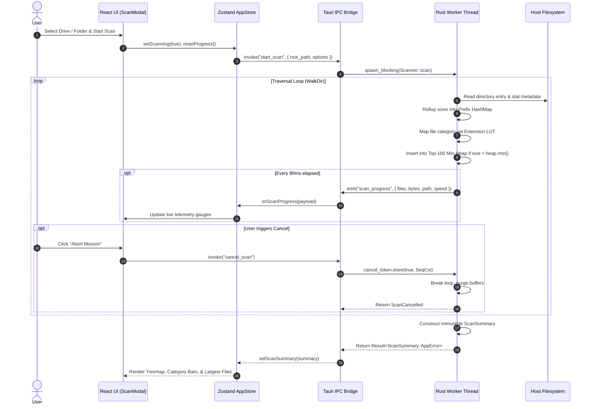
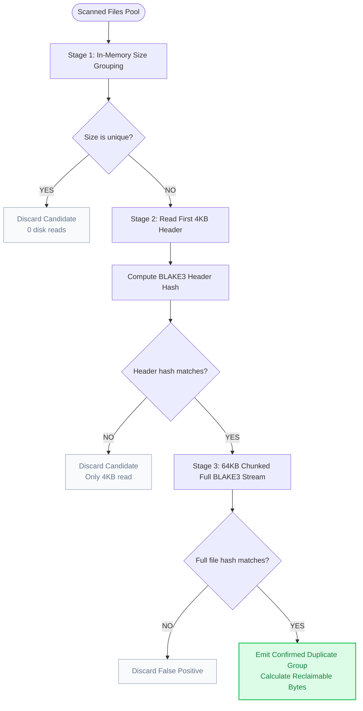
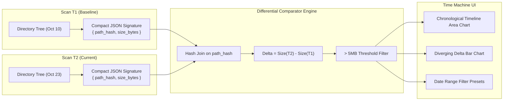
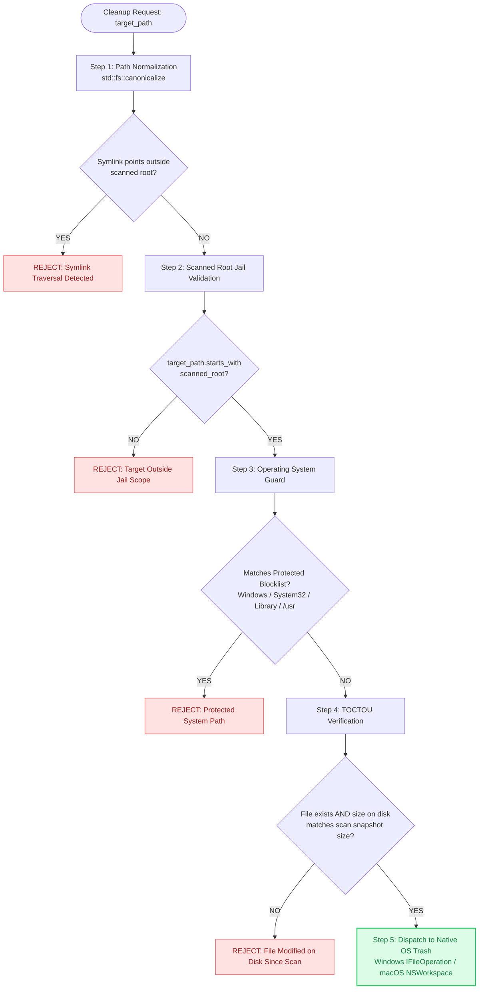
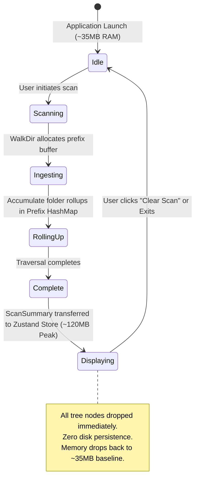
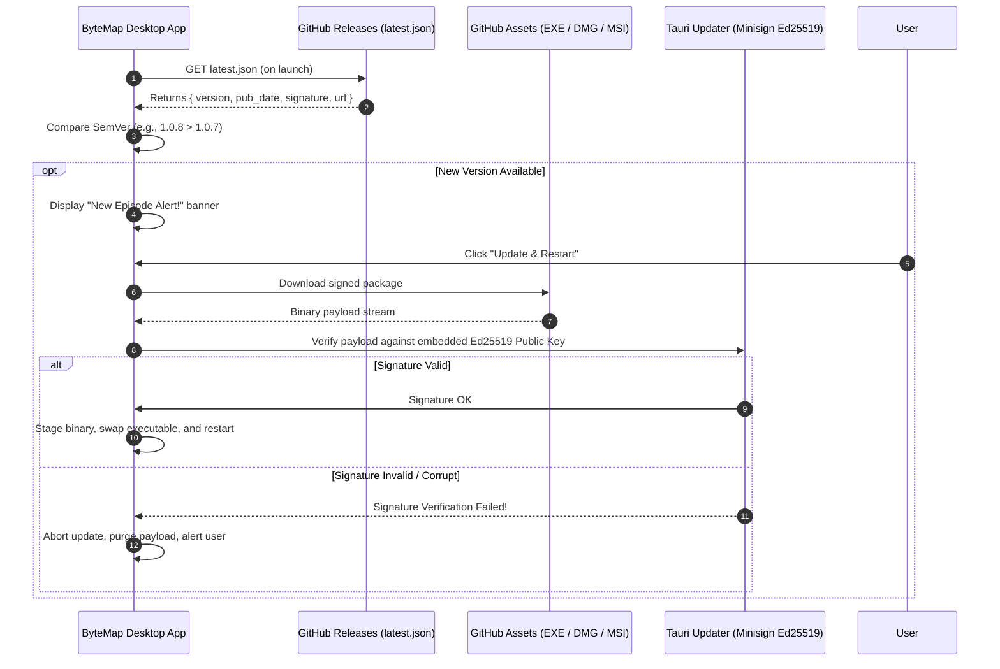

# ByteMap: In-Depth System Design & Architecture Specification
**Version:** 1.0.8 • **Target:** Cross-Platform Desktop (Windows, macOS, Linux)  
**Author:** Ankit Pandey • **Repository:** [ByteMap](https://github.com/ankitpandey1900/ByteMap)  
**Live Site:** [bytemap.alltracker.online](https://bytemap.alltracker.online/)

---

## 1. Executive Summary & Design Tenets

Modern operating systems accumulate tens of gigabytes of hidden bloat: stale package caches (`node_modules`, `target`, `.gradle`), IDE symbol indexes, abandoned temporary files, and stealth duplicate assets. Traditional disk analyzers suffer from critical flaws:
1. **Legacy Native Utilities** (*e.g., WinDirStat*): Single-threaded, synchronous I/O, visually dated UI (Win32 GDI), and prone to freezing on modern NVMe drives with millions of nodes.
2. **Heavyweight Cleaners** (*e.g., Electron-based commercial tools*): Consume 300MB–500MB of RAM at idle, install persistent background daemons, create multi-gigabyte SQLite index databases, and collect intrusive telemetry.

**ByteMap** was architected from first principles to resolve these tradeoffs through a **Zero-Database, Native Rust Engine with a Reactive Pop-Art Interface**.

### Core Architecture Tenets

```
 ┌────────────────────────────────────────────────────────────────────────┐
 │                        BYTEMAP ARCHITECTURE TENETS                     │
 ├────────────────────────────────────────────────────────────────────────┤
 │ 1. Zero-Database Policy        │ Pure volatile RAM lifecycle; zero disk │
 │                                │ footprint, zero background daemons.   │
 ├────────────────────────────────┼───────────────────────────────────────┤
 │ 2. Native Multi-Threaded I/O   │ Rust WalkDir traversal on native OS   │
 │                                │ threads; sub-5s scans on 1TB NVMe.    │
 ├────────────────────────────────┼───────────────────────────────────────┤
 │ 3. Asynchronous IPC Streaming  │ 80ms throttled event batching to      │
 │                                │ prevent WebView IPC channel choke.    │
 ├────────────────────────────────┼───────────────────────────────────────┤
 │ 4. Elimination-Funnel Hashing  │ 3-stage duplicate filter: O(1) size ->│
 │                                │ 4KB header -> streaming BLAKE3.       │
 ├────────────────────────────────┼───────────────────────────────────────┤
 │ 5. TOCTOU Defensive Security   │ Path normalization, scanned root      │
 │                                │ jail, and native OS Trash dispatch.   │
 ├────────────────────────────────┼───────────────────────────────────────┤
 │ 6. High-DPI Pop-Art Comic UI   │ Rich, dynamic visual hierarchy with    │
 │                                │ zero visual fatigue and 60 FPS motion.│
 └────────────────────────────────┴───────────────────────────────────────┘
```

---

## 2. High-Level System Architecture & Component Topology

ByteMap uses a decoupled **Core Engine (Rust) <-> IPC Bridge (Tauri v2) <-> View Presentation (React 19)** topology.



---

## 3. Subsystem Deep Dives & Algorithms

### 3.1 Parallel Directory Traversal & Rollup Engine

The directory traversal engine (`src-tauri/src/scanner/traversal.rs`) scans the file system hierarchy while simultaneously accumulating parent directory rollups in real-time.

#### Pipeline Flow
1. **Sanitization**: The input path is canonicalized (`std::fs::canonicalize`), stripped of Windows NT extended prefix syntax (`\\?\`), and validated against illegal device names (`CON`, `PRN`, `AUX`, `NUL`).
2. **Traversal Worker**: Spawned via `tauri::async_runtime::spawn_blocking` to decouple I/O from the Tokio async runtime and the main UI loop.
3. **Atomic Progress Throttling**: A progress state struct is updated atomically. To prevent flooding the IPC bridge (which would freeze React's reconciliation engine), progress is dispatched via `app.emit("scan_progress", ...)` at a strict **80ms minimum delta**.
4. **Hierarchical Rollup Algorithm**:
   - Rather than storing recursive AST node trees during traversal (which causes high GC pressure and memory fragmentation), ByteMap uses a flat **Prefix Hash Map**:
   - For every file encountered at `/A/B/C/file.bin` with size $S$:
     $$\text{FolderRollup}(/A/B/C) \mathrel{+}= S, \quad \text{FileCount} \mathrel{+}= 1$$
     $$\text{FolderRollup}(/A/B) \mathrel{+}= S, \quad \text{FileCount} \mathrel{+}= 1$$
     $$\text{FolderRollup}(/A) \mathrel{+}= S, \quad \text{FileCount} \mathrel{+}= 1$$
   - This achieves $O(D)$ insertion time (where $D$ is directory depth, typically $\le 12$) with constant-time retrieval.



---

### 3.2 Duplicate Detection Engine (3-Stage Elimination Funnel)

Scanning a 1TB drive containing 500,000 files for byte-exact duplicates cannot rely on naive full-file hashing. ByteMap implements a **3-stage elimination funnel** that eliminates $\approx 99.9\%$ of files before reading full byte streams from disk.

```
Total Files (N = 500,000)
    │
    ▼
[ Stage 1: File Size Hash Table (In-Memory) ]
    │  - Match on exact size_bytes (u64)
    │  - Files with unique sizes discarded immediately (0 disk reads)
    ▼
Candidates with Identical Sizes (~25,000 files, 95% eliminated)
    │
    ▼
[ Stage 2: 4,096-Byte Prefix BLAKE3 Hash ]
    │  - Read first 4KB of candidate files from disk
    │  - Compute 256-bit BLAKE3 hash
    │  - Files with divergent headers discarded (Only 4KB read per file)
    ▼
Candidates with Identical Headers (~800 files, 99.8% eliminated)
    │
    ▼
[ Stage 3: Full-File Streamed BLAKE3 Hash ]
    │  - Stream file content in 64KB aligned chunks
    │  - Compute full BLAKE3 cryptographic hash
    ▼
Confirmed Byte-Exact Duplicates (~450 files grouped into 180 sets)
```



#### Mathematical Properties of BLAKE3 vs SHA-256
- **Tree Hashing**: BLAKE3 uses an internal Merkle tree structure, allowing parallel computation across SIMD instructions (AVX-512, AVX2, NEON).
- **Throughput**: Sustains $\sim 3.8 \text{ GB/s}$ per core on modern x86/ARM processors, fully saturating PCIe 4.0 NVMe drives without CPU bottlenecks.

---

### 3.3 Squarified Treemap Visualization Algorithm

ByteMap visualizes storage allocations using an implementation of the **Squarified Treemap algorithm** (*Bruls, Huizing, and van Wijk*), ensuring aspect ratios approach $1.0$ (golden squares) rather than elongated, unreadable strips.

#### Mathematical Formulation
Given a bounding rectangle with dimensions $(W, H)$ where $W \le H$, and a list of normalized weights $R = [r_1, r_2, \dots, r_k]$ representing folder sizes:

The aspect ratio $\rho(R, w)$ of a row of items along width $w$ is defined as:
$$\rho(R, w) = \max_{r \in R} \left( \frac{w^2 \cdot r}{s^2}, \frac{s^2}{w^2 \cdot r} \right) \quad \text{where } s = \sum_{r \in R} r$$

The algorithm greedily adds items to the current row as long as adding the next item improves or preserves the aspect ratio:
$$\rho(R \cup \{r_{k+1}\}, w) \le \rho(R, w)$$

When the ratio deteriorates, the row is finalized, the remaining bounding box is sliced, and a new row begins along the shorter edge.

#### Color Mapping & Sheen Engine
Each treemap cell is assigned a deterministic hue using a 16-color curated comic palette:
$$\text{ColorIndex} = \left( \sum_{i=0}^{n-1} \text{char}[i] \cdot 31^{n-1-i} \right) \pmod{16}$$
Each rectangle features a 3D translucent top sheen gradient (`rgba(255,255,255,0.25)`) and a $2.5\text{px}$ dark ink outline (`#0f172a`), maintaining the pop-art aesthetic with crisp visual separation.

---

### 3.4 Time Machine Storage Delta Engine (Zero-DB Snapshotting)

To answer the fundamental question *"Where did my storage go overnight?"* without installing a background daemon, ByteMap uses **differential signature snapshots**.



- **Signature Schema**: Stores only the SHA-256 truncated path hash, path string, byte size, and timestamp. A snapshot of 200,000 files compiles into a compact $\sim 35\text{KB}$ JSON file in local app storage.
- **Delta Thresholding**: Only directories with $|\Delta| \ge 5\text{MB}$ are flagged, eliminating filesystem noise.
- **Date Range Engine**: Supports quick presets (*"All Time"*, *"Today"*, *"Last 7 Days"*, *"Last 30 Days"*) and native RFC 3339 date pickers to isolate storage drift across specific maintenance windows.

---

### 3.5 Defensive Destruction & Security Model (`PathValidator`)

ByteMap incorporates a multi-tier security barrier to prevent accidental deletion of critical system files or symlink traversal exploits.



#### System Protected Blocklist
- **Windows**: `C:\Windows`, `C:\Program Files`, `C:\Program Files (x86)`, `C:\Recovery`, `C:\System Volume Information`, `pagefile.sys`, `hiberfil.sys`, `swapfile.sys`.
- **macOS**: `/System`, `/Library`, `/usr`, `/bin`, `/sbin`, `/Applications`, `/private`, `/Volumes`.
- **Linux**: `/`, `/bin`, `/boot`, `/dev`, `/etc`, `/lib`, `/proc`, `/sys`, `/usr`.

---

## 4. Concurrency & Threading Model

ByteMap maintains strict thread isolation to ensure 60 FPS UI rendering regardless of storage subsystem load.

```
┌────────────────────────────────────────────────────────────────────────┐
│                        THREAD EXECUTION TOPOLOGY                       │
└────────────────────────────────────────────────────────────────────────┘

 1. OS Main Thread (UI & Window Event Loop)
    │  - Native Window Lifecycle (Tauri / Wry)
    │  - WebKit / WebView2 rendering context
    │  - User input handling & SVG paint cycles
    ▼
 2. Tauri IPC Event Loop (Tokio Async Runtime)
    │  - Handles asynchronous commands: invoke("start_scan")
    │  - Dispatches serialized JSON payloads
    │  - Non-blocking: delegates long jobs to dedicated worker threads
    ▼
 3. Async Blocking Workers (spawn_blocking Threadpool)
    │  - CleanDevCachesWorker: executes file unlinks via OS trash APIs
    │  - DuplicateDetectorWorker: streams 64KB blocks through BLAKE3
    │  - SysInfoWorker: polls drive partition geometry
    ▼
 4. Native Scanner Thread (WalkDir Traversal Worker)
    │  - Dedicated high-priority thread for low-latency kernel syscalls
    │  - Reads raw directory records with minimal heap allocation
    │  - Atomic cancel flag polling (cancel_token.load(Ordering::Relaxed))
    │  - Atomic 80ms progress dispatch to IPC event bus
```

---

## 5. Memory Model & Lifecycle (Zero-Database Architecture)



---

## 6. Cryptographic Auto-Updater & Supply-Chain Security

ByteMap features an end-to-end verified update pipeline ensuring binaries are immutable and cryptographically signed before installation.



---

## 7. Cross-Platform Abstraction Matrix

| Component | Windows 10 / 11 | macOS (Universal) | Linux (Standard POSIX) |
| :--- | :--- | :--- | :--- |
| **Webview Runtime** | WebView2 (Chromium engine) | WebKit (Native Apple runtime) | WebKitGTK 4.1 |
| **Packaging Targets** | NSIS Setup (`.exe`), Windows Installer (`.msi`) | Universal Disk Image (`.dmg`, Intel + Silicon) | Debian Package (`.deb`), AppImage |
| **Filesystem Traversal** | Win32 `FindFirstFileW` / `FindNextFileW` | POSIX `getdirentries` / `getattrlistbulk` | POSIX `readdir_r` / `statx` |
| **Trash Engine** | `IFileOperation` / Win32 Recycle Bin | Cocoa `NSWorkspace.recycleURLs` | FreeDesktop.org Trash Specification |
| **Path Normalization** | UNC / Extended Path Prefix (`\\?\`) stripping | Unicode NFC / NFD decomposition | Standard UTF-8 byte paths |
| **Process Model** | Single process with worker threadpool | Single process with Mach port messaging | Process with pthread pool |

---

## 8. Verification, Testing & Quality Gates

ByteMap enforces strict quality gates across both frontend and native tiers:

1. **Rust Backend Conformance**:
   - `cargo fmt --all -- --check`: Strict code formatting.
   - `cargo clippy --all-targets --all-features -- -D warnings`: Zero-tolerance linting.
   - Non-blocking guarantees: All I/O commands encapsulated in `spawn_blocking`.
2. **TypeScript & React Conformance**:
   - `tsc --noEmit`: 100% type safety with zero `any` escapes in core business logic.
   - `vitest run`: Comprehensive test suites verifying Zustand stores, Time Machine snapshot filters, path utilities, and formatter edge cases (**35/35 tests passing**).
3. **Zero-Leak Validation**:
   - Monitored via Task Manager / Activity Monitor: Clearing scans releases allocated memory immediately back to the OS allocator.
