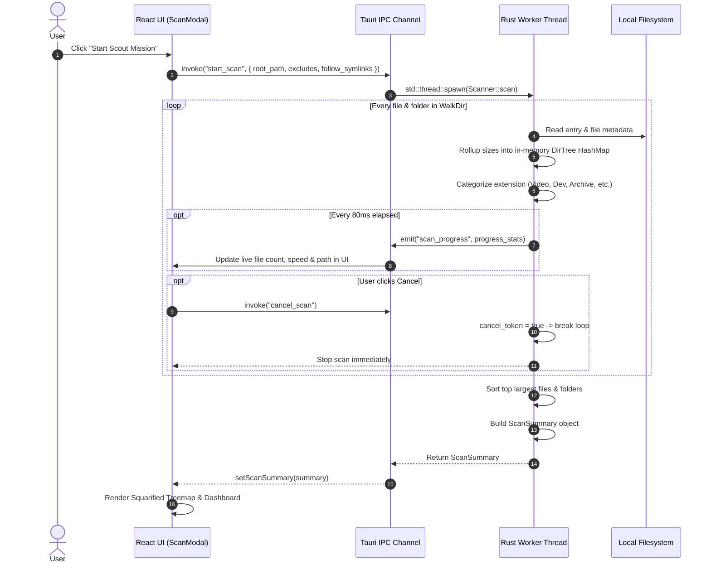
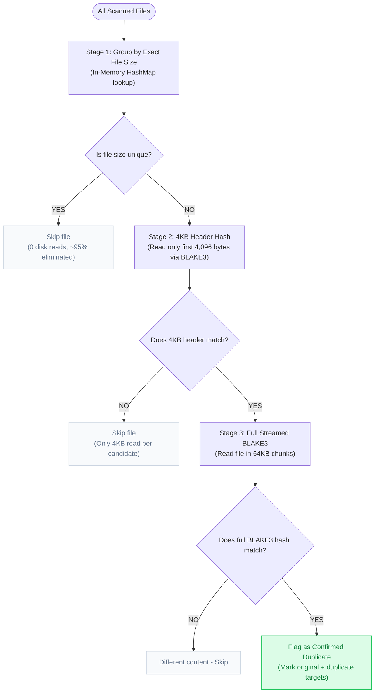
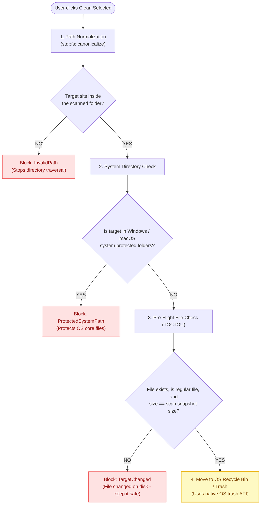

# ByteMap System Design

How ByteMap works under the hood — architecture, data flow, background threads, and safety checks.

- **Author**: Ankit Pandey
- **Repo**: [github.com/ankitpandey1900/ByteMap](https://github.com/ankitpandey1900/ByteMap)
- **Website**: [bytemap.alltracker.online](https://bytemap.alltracker.online/)

---

## 1. Design Philosophy

Most disk visualizers either look like they were built in 1998 (WinDirStat) or they are heavy Electron apps that write huge SQLite databases to your disk and chew up 400MB of RAM at idle.

ByteMap takes a completely different approach:

1. **Zero-Database Policy**: All scan results live strictly in memory (RAM). When you close the app or clear the scan, everything is dropped. Nothing gets saved to disk, so there are no stale indexes, no ghost files, and no disk bloat.
2. **100% Offline & Private**: ByteMap never phones home. There are no telemetry pings, no analytics SDKs, and no tracking. File names stay on your machine.
3. **Rust + Tauri 2**: Rust handles the heavy directory traversal and BLAKE3 hashing on native OS threads. The UI runs on React in the native OS webview (WebView2 on Windows, WebKit on macOS), keeping idle RAM under 40MB.
4. **Throttled IPC (80ms)**: Instead of sending an IPC event for every file found (which freezes the webview when scanning millions of files), Rust batches updates and sends them every 80ms (~12 times a second). The UI stays smooth at 60 FPS.
5. **Safety First**: Destructive operations always default to the OS Recycle Bin / Trash and require confirmation. Every target path is checked against protected system directories before anything happens.

---

## 2. High-Level Architecture

Here is the overall layout of ByteMap and how the layers talk to each other:

```
+-------------------------------------------------------------------------------+
|                             REACT 19 FRONTEND                                 |
|                                                                               |
|   Header (Stats & Mascot)       Drive Picker / Scout      Display Zoom Engine |
|                                                                               |
|   Overview & Treemap            Time Machine (Snapshots)  Duplicates Studio   |
|   (Squarified layout)           (Compare folder deltas)   (3-tier BLAKE3)     |
|                                                                               |
|   Explore & Large Files         Dev Bloat Sweeper         HTML Audit Exporter |
|   (Paginated table)             (node_modules, target)    (Self-contained)    |
|                                                                               |
|   State: Zustand (useAppStore) — 100% in-memory, resets on app exit           |
+---------------------------------------▲---------------------------------------+
                                        │
                       Tauri 2 IPC Bridge (Bidirectional)
                    - Commands: invoke("start_scan", { ... })
                    - Events: listen("scan_progress", ...) every 80ms
                                        │
+---------------------------------------▼---------------------------------------+
|                            RUST CORE BACKEND                                  |
|                                                                               |
|   Scanner Worker               Duplicate Detector         Drive Discovery     |
|   - WalkDir traversal          - Tier 1: File size match  - sysinfo::Disks    |
|   - In-memory rollup           - Tier 2: 4KB prefix hash  - Mount points      |
|   - 80ms progress batcher      - Tier 3: Streamed BLAKE3  - Free / used space |
|                                                                               |
|   PathValidator Guard          Safe File Removal          Auto-Updater        |
|   - Canonical path check       - trash::delete API        - Checks latest.json|
|   - System folder blocklist    - Size recheck (TOCTOU)    - Minisign verify   |
|   - Strips \\?\ NT prefixes    - Optional hard delete     - Pop-up alert      |
+---------------------------------------▲---------------------------------------+
                                        │
                           Operating System APIs
                                        │
+---------------------------------------▼---------------------------------------+
|                               OS KERNEL                                       |
|                                                                               |
|      Windows (NTFS / FAT32)        macOS (APFS)             Linux (ext4)      |
|     Win32 IFileOperation / Bin   NSWorkspace Trash        POSIX Trash Spec    |
+-------------------------------------------------------------------------------+
```

---

## 3. Core Workflows & Diagrams

### Scanning & Rollup Engine

When you click "Start Scout Mission", the Rust backend spawns a background thread so the UI never blocks. As it walks directories, it rolls file sizes up into their parent folders on the fly.



---

### Duplicate Detection (3-Stage Filter)

Hashing every file on a 1TB drive would kill your disk read speed. ByteMap uses an elimination funnel where ~95% of files are ruled out before reading any bytes at all:



---

### Safe Cleanup Checks (PathValidator)

Before moving any file to the Trash or deleting it, ByteMap runs it through four strict checks to make sure we never touch system files or files that were modified after the scan:



---

### Time Machine Snapshots (Without a Database)

To answer *"Where did my disk space go overnight?"*:

1. **Save Baseline**: When viewing a scan, click "Save Baseline Snapshot".
2. **Tiny Signature File**: ByteMap saves a small JSON file containing just directory path hashes and byte sizes. No file lists, no heavy logs.
3. **Compare**: Next time you scan the same folder, ByteMap compares the two:
   - Folder size change = `current_size - baseline_size`
   - File count change = `current_count - baseline_count`
4. **Spotlight Swollen Folders**: Folders that grew by more than 5MB are highlighted immediately so you can see what swelled up.

---

### In-App Auto-Updater

ByteMap includes a built-in cryptographic updater so you get notified when a new version drops:

```
[ New Git Tag pushed (v1.0.6) ]
              │
              ▼
[ GitHub Actions Workflow ]
  - Builds Windows .exe + NSIS installer
  - Builds macOS .dmg (Apple Silicon & Intel)
  - Signs binaries with ed25519 Minisign private key
  - Generates latest.json manifest with signatures and release notes
  - Uploads everything to GitHub Releases
              │
              ▼
[ ByteMap Desktop Client ]
  1. On launch, checks latest.json on GitHub Releases
  2. Compares semantic version with installed version
  3. Verifies cryptographic signature using public key in tauri.conf.json
  4. Shows "New Episode Alert!" pop-up in app
  5. User clicks "Update & Restart" -> downloads, verifies, installs, relaunches
```

---

## 4. Key Data Models (Rust <-> TypeScript)

The Rust backend and React frontend communicate with strictly typed models over Tauri IPC:

| Struct / Type | Key Fields | What it does |
| :--- | :--- | :--- |
| **`DriveInfo`** | `id, name, mount_point, total_bytes, used_bytes, available_bytes, filesystem` | Drive partition stats found via `sysinfo::Disks`. |
| **`ScanOptions`** | `root_path, exclude_hidden, exclude_patterns, follow_symlinks` | User options passed to the scanner. |
| **`ScanProgress`** | `scanned_files, scanned_directories, scanned_bytes, current_path, elapsed_ms` | Telemetry emitted every 80ms during active scan. |
| **`ScannedFile`** | `id, name, path, size_bytes, category, extension, modified_at` | Metadata for individual files. |
| **`DirectoryRollup`**| `path, name, size_bytes, file_count` | Aggregated folder node rolled up during traversal. |
| **`ScanSummary`** | `root_path, total_bytes, total_files, largest_files, largest_folders, categories` | Complete immutable summary returned once scan finishes. |
| **`DuplicateGroup`**| `hash, size_bytes, reclaimable_bytes, original, duplicates` | Confirmed group of identical files. |
| **`CleanupCandidate`**| `id, file, reason, risk_level` | Suggested junk file (cache, old installer, build artifact). |

---

## 5. Cross-Platform Details

| Feature | Windows (10 / 11) | macOS (Apple Silicon / Intel) | Linux (Ubuntu / Fedora / Arch) |
| :--- | :--- | :--- | :--- |
| **Webview** | WebView2 (Chromium) | WebKit (Native) | WebKitGTK 4.1 |
| **Installers** | `.exe` (NSIS), `.msi` | `.dmg` | `.deb`, `.AppImage` |
| **Path Handling** | Strips `\\?\` NT extended prefix | Standard POSIX paths | Standard POSIX paths |
| **Trash Engine** | Windows Recycle Bin (`IFileOperation`) | macOS Trash (`NSWorkspace`) | FreeDesktop.org Trash spec |
| **Protected Folders** | `C:\Windows`, `C:\Program Files`, `C:\Recovery` | `/System`, `/Library`, `/Applications` | `/bin`, `/sbin`, `/usr`, `/etc`, `/sys` |

---

## 6. How We Test

- **Unit tests**: 26 Vitest test suites cover in-memory store actions, byte formatters, path cleaning, and drive matching.
- **Frontend types**: Strict TypeScript (`tsc --noEmit`) runs on every commit and build.
- **Rust safety**: `cargo fmt --all --check` and `cargo clippy` keep Rust code clean and warning-free.
- **Zero-Database check**: Verified via tests that clearing a scan drops all references and frees memory back to the OS immediately.
