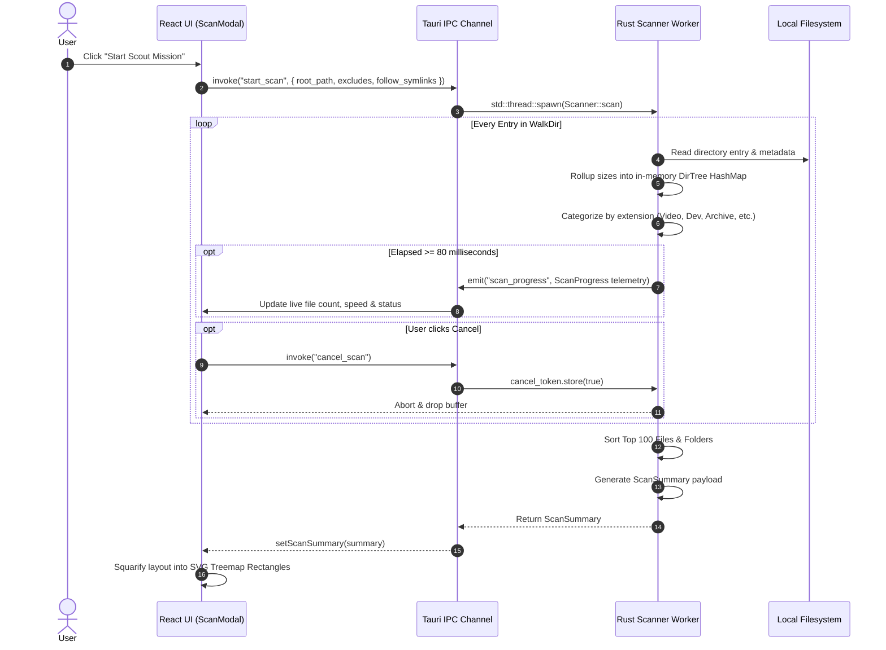
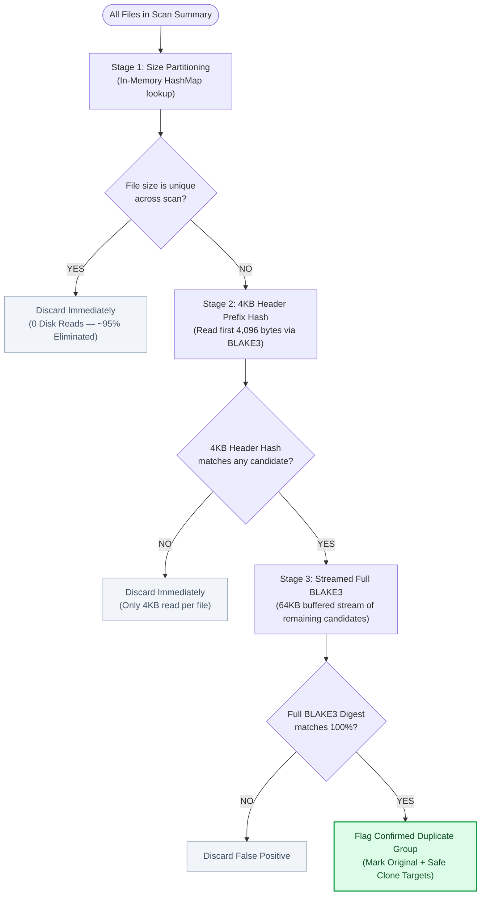
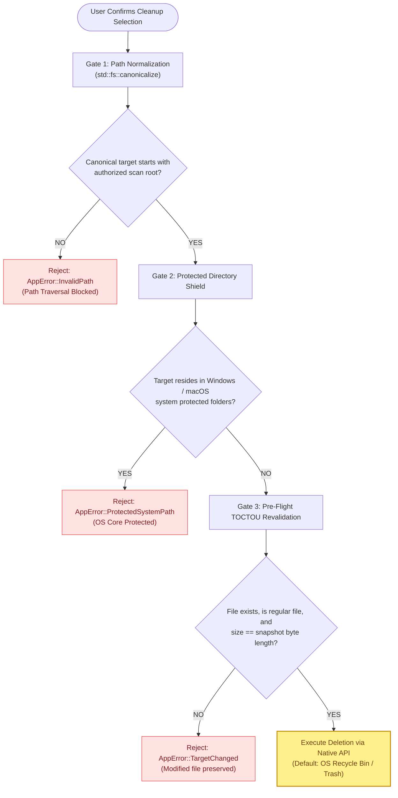

# 🏗️ ByteMap — System Design & Architecture Specification

> **Desktop Storage Intelligence | 100% Offline & Private | Zero-Database Policy**  
> *Author & Lead Architect: Ankit Pandey*  
> *Repository: [https://github.com/ankitpandey1900/ByteMap](https://github.com/ankitpandey1900/ByteMap)*  
> *Live Website: [https://bytemap.alltracker.online/](https://bytemap.alltracker.online/)*

---

## 1. Executive Summary & Core Design Philosophy

Traditional disk visualizers (WinDirStat, TreeSize, CleanMyMac) suffer from three fatal architecture flaws:
1. **The Database Trap**: They index file systems into SQLite, RocksDB, or LocalStorage. Over weeks, the cache grows stale, leads to dangerous ghost-file recommendations, and hogs gigabytes of SSD space.
2. **The Bloat & Telemetry Trap**: Electron-based visualizers bundle full Chromium runtimes (250MB+ idle RAM) and bundle telemetry SDKs that transmit private file names over the wire.
3. **The IPC Choke Trap**: Naive desktop webviews emit events for every individual file encountered, queuing 100,000+ IPC messages and freezing the UI thread at 2 FPS.

### The ByteMap Architecture Principles:
- **Zero-Database Policy (ADR-001)**: Scan state is strictly ephemeral in RAM. The moment ByteMap quits or "Clear Scan" is clicked, all memory is dropped. Zero disk residue.
- **Throttled Push Pipeline**: Background worker threads batch progress events every 80ms (~12 updates/sec), keeping UI animations locked at 60 FPS regardless of filesystem density.
- **Single-Pass Rollup Engine**: Directory sizes roll up dynamically into parent nodes during tree traversal, computing aggregated disk consumption with zero second-pass overhead.
- **Staged 3-Tier Hasher (ADR-002)**: Eliminates 95% of disk reads by gating duplicate candidate files through Size Matching $\to$ 4KB Prefix Hashes $\to$ Streamed BLAKE3.
- **Safety Sentinel (TOCTOU Defense)**: Every destructive action validates path boundaries, checks protected system directories, and verifies that the file size on disk has not shifted since the scan snapshot.

---

## 2. High-Level System Architecture

```
+───────────────────────────────────────────────────────────────────────────────+
│                            PRESENTATION LAYER                                 │
│                                                                               │
│   [ Pop-Art Header ]      [ Scan Target Scout ]       [ Display Scaling ]     │
│   (Stats, Brand, Mascot)  (Browse, Drive Pills)       (5% Step Zoom Engine)   │
│                                                                               │
│   [ Digital Kingdom ]     [ Time Machine ]            [ Duplicate Studio ]    │
│   (Squarified Treemap)    (Delta Baseline Engine)     (3-Stage BLAKE3 Clones) │
│                                                                               │
│   [ Explore & Files ]     [ Dev Bloat Sweeper ]       [ Audit HTML Exporter ] │
│   (Paginated 50/page)     (node_modules, target)      (Self-contained Report) │
│                                                                               │
│   State Engine: Zustand (useAppStore) — 100% Ephemeral In-Memory Store        │
+──────────────────────────────────────▲────────────────────────────────────────+
                                       │
                      Tauri 2 IPC Bridge (Bidirectional)
                   - Commands: JSON-RPC over native webview
                   - Events: Async 80ms throttled push channel
                                       │
+──────────────────────────────────────▼────────────────────────────────────────+
│                          RUST CORE BACKEND ENGINE                             │
│                                                                               │
│  +─────────────────────────+  +─────────────────────────+  +────────────────+  │
│  │   Scanner & Rollup      │  │  Staged BLAKE3 Hasher   │  │ Drive Explorer │  │
│  │  - WalkDir worker       │  │  - Stage 1: Size Match  │  │ - sysinfo      │  │
│  │  - 80ms event batcher   │  │  - Stage 2: 4KB Header  │  │ - Mount points │  │
│  │  - Atomic cancel token  │  │  - Stage 3: 64KB Stream │  │ - Filesystems  │  │
│  +─────────────────────────+  +─────────────────────────+  +────────────────+  │
│                                                                               │
│  +─────────────────────────+  +─────────────────────────+  +────────────────+  │
│  │   PathValidator Guard   │  │   Safe File Operator    │  │ Minisign Update│  │
│  │  - Canonical boundary   │  │  - Native Recycle Bin   │  │ - Public Key   │  │
│  │  - System directory ban │  │  - Pre-flight recheck   │  │ - latest.json  │  │
│  │  - NT path unprefixer   │  │  - Optional permanent   │  │ - Auto restart │  │
│  +─────────────────────────+  +─────────────────────────+  +────────────────+  │
+──────────────────────────────────────▲────────────────────────────────────────+
                                       │
                          Operating System Native APIs
                                       │
+──────────────────────────────────────▼────────────────────────────────────────+
│                     OS KERNEL & HARDWARE FILESYSTEMS                          │
│                                                                               │
│     Windows 10 / 11            macOS (Apple Silicon & Intel)       Linux      │
│  (NTFS, ReFS, FAT32)               (APFS, HFS+, FAT32)             (ext4)     │
│  Win32 IFileOperation / Recycle   Cocoa NSWorkspace / Trash      POSIX Trash  │
+───────────────────────────────────────────────────────────────────────────────+
```

---

## 3. Subsystem Deep-Dives & Workflow Diagrams

### Subsystem A: Storage Traversal & Rollup Aggregation

When the user launches an analysis on a drive or folder, the scanning engine executes on a dedicated background OS thread to isolate CPU-intensive operations from the frontend renderer.



---

### Subsystem B: 3-Stage Duplicate Detection Pipeline (ADR-002)

Computing full cryptographic hashes across an entire drive grinds storage I/O to a halt. ByteMap solves this by implementing an algorithmic elimination funnel:



---

### Subsystem C: PathValidator Security Guard & TOCTOU Defense

To prevent path traversal, malicious symlink manipulation, or background file modifications, every cleanup operation must pass four mandatory validation gates before touching disk:



---

### Subsystem D: Time Machine Delta Snapshot Engine

ByteMap enables users to answer *"Where did my disk space disappear overnight?"* by storing baseline structural signatures without maintaining a heavy database:

1. **Snapshot Creation**: Users click **Save Baseline Snapshot** on any analyzed drive or directory.
2. **Compact Signature Storage**: ByteMap writes a lightweight schema containing only directory path hashes, byte sizes, and file counts to local storage or memory.
3. **Delta Comparison**: Upon a future scan of the same root:
   $$\Delta_{\text{bytes}} = \text{Current Size} - \text{Baseline Size}$$
   $$\Delta_{\text{files}} = \text{Current File Count} - \text{Baseline File Count}$$
4. **Surfacing Hogs**: ByteMap filters for nodes where $|\Delta_{\text{bytes}}| \ge 5\,\text{MB}$, instantly categorizing folders into **Expanded (Hogs)**, **Shrunk (Freed)**, or **Newly Spawned**.

---

### Subsystem E: Cryptographic Auto-Updater & Rollout Architecture

ByteMap integrates an end-to-end continuous deployment and automated in-app updater:

```
[ Git Version Tag (vX.Y.Z) ]
            │
            ▼
[ GitHub Actions Multi-Platform Runner ]
 ├── Windows Runner: Builds NSIS .exe, MSI .msi, and updater tarball
 └── macOS Runner: Builds Universal .dmg and .app.tar.gz
            │
            ▼
[ Minisign Private Key Signing ]
Payloads signed with ed25519 cryptographic key (TAURI_SIGNING_PRIVATE_KEY)
            │
            ▼
[ GitHub Releases Publication ]
Artifacts + latest.json published to GitHub Releases
            │
            ▼
[ Client-Side Tauri Plugin Updater ]
 1. App launches → 3s timer triggers check against latest.json
 2. Compares semantic version with installed binary
 3. Verifies Minisign signature against embedded pubkey in tauri.conf.json
 4. Displays Pop-Art "New Episode Alert!" modal to user
 5. User clicks "Update & Restart" → Atomic download, verification & hot relaunch
```

---

## 4. Data Models & IPC Contracts

The interface between Rust and React is strictly typed through Serde serializable structs matching TypeScript definitions:

### Core Data Transfer Objects (`src/types/index.ts` $\iff$ `src-tauri/src/models/`):

| Struct / Interface | Key Properties | Purpose |
| :--- | :--- | :--- |
| **`DriveInfo`** | `id, name, mount_point, total_bytes, used_bytes, available_bytes, filesystem, is_removable` | Physical drive partition telemetry discovered via `sysinfo::Disks`. |
| **`ScanOptions`** | `root_path, exclude_hidden, exclude_patterns, follow_symlinks, deep_duplicate_scan` | User configuration passed to the traversal engine. |
| **`ScanProgress`** | `status, scanned_files, scanned_directories, scanned_bytes, current_path, elapsed_ms, error_count` | 80ms throttled telemetry emitted during background traversal. |
| **`ScannedFile`** | `id, name, path, size_bytes, category, extension, modified_at, is_hidden, is_system` | Metadata record for individual files. |
| **`DirectoryRollup`**| `path, name, size_bytes, file_count` | Aggregated folder node rolled up during tree traversal. |
| **`ScanSummary`** | `root_path, total_bytes, total_files, total_directories, largest_files, largest_folders, categories, duplicate_groups` | Comprehensive immutable snapshot returned upon scan completion. |
| **`DuplicateGroup`**| `hash, size_bytes, reclaimable_bytes, original, duplicates` | Cryptographically confirmed duplicate set. |
| **`CleanupCandidate`**| `id, file, reason, risk_level (Safe/Low/Moderate)` | Automated cleanup suggestion for temp files, old installers, or artifacts. |

---

## 5. Cross-Platform Operating System Matrix

| Feature | Windows (10 / 11) | macOS (Apple Silicon / Intel) | Linux (Ubuntu / Fedora / Arch) |
| :--- | :--- | :--- | :--- |
| **Webview Runtime** | WebView2 (Chromium Evergreen) | WebKit (Native WKWebView) | WebKitGTK 4.1 |
| **Packaging Target** | `.exe` (NSIS Setup), `.msi` (Enterprise) | `.dmg` (Universal Disk Image) | `.deb` (Debian/Ubuntu), `.AppImage` |
| **Path Prefixing** | Strips `\\?\` and `\\?\UNC\` via `cleanDisplayPath` | Standard POSIX Unix paths | Standard POSIX Unix paths |
| **Default Safe Delete** | Windows Recycle Bin (`IFileOperation`) | macOS Trash (`NSWorkspace`) | FreeDesktop.org Trash Specification |
| **Protected System Paths**| `C:\Windows`, `C:\Program Files`, `C:\Recovery` | `/System`, `/Library`, `/Applications`, `/private` | `/bin`, `/sbin`, `/usr`, `/etc`, `/sys`, `/proc` |
| **Minimum OS Version** | Windows 10 (64-bit) | macOS 10.13 (High Sierra) | Kernel 5.4+ with glibc 2.31+ |

---

## 6. Verification & Quality Assurance Protocols

1. **Unit & Component Testing**: Verified across 26 Vitest test suites simulating pure in-memory state, mathematical formatting, path cleaning, and drive matching.
2. **Frontend Type Safety**: Strict TypeScript (`tsc --noEmit`) integrated into pre-commit and pre-build pipelines.
3. **Rust Memory & Safety Checking**: `cargo fmt --all --check` and `cargo clippy --all-targets -- -D warnings` enforced on all pull requests and releases.
4. **Zero-Database Verification**: Confirmed via audit tests that clearing a scan drops all references, releasing 100% of allocated buffer memory back to the operating system.
